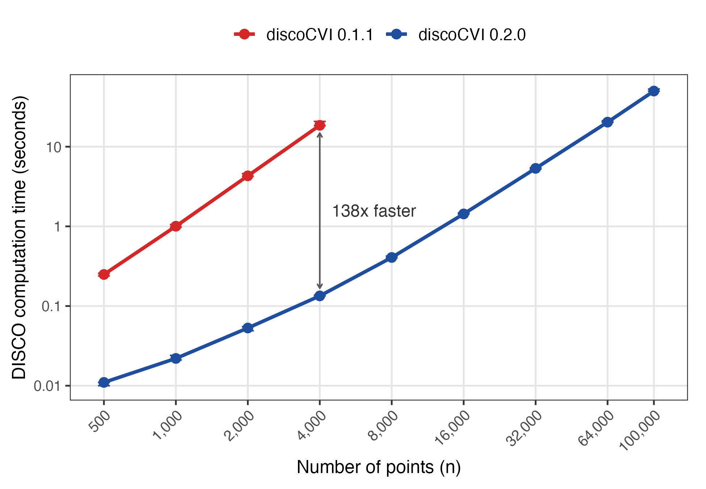
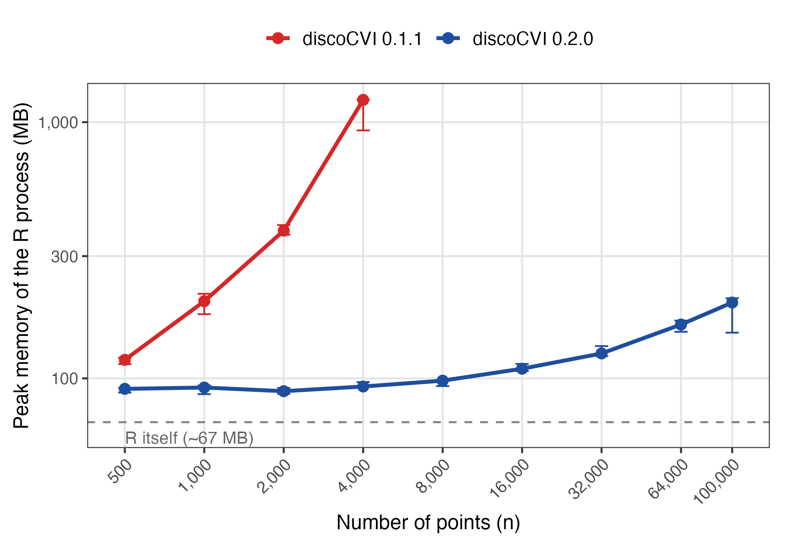
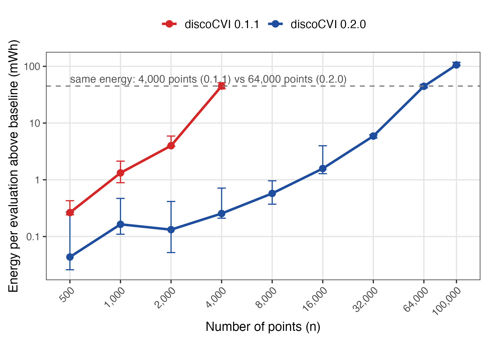

```{r setup, include=FALSE}
knitr::opts_chunk$set(echo = FALSE, warning = FALSE, message = FALSE)
library(discoCVI)
library(dbscan)
res <- read.csv("data/results_summary.csv")
```

# Introduction

Clustering without ground truth needs internal cluster validity indices
(CVIs), which score a partition using only the data and the labels. For
density-based algorithms such as DBSCAN [@ester1996dbscan] and HDBSCAN
[@campello2013hdbscan], classical indices such as the silhouette coefficient
[@rousseeuw1987silhouette] are a poor fit: they favour convex clusters and
have no notion of noise. Density-based indices such as DBCV
[@moulavi2014dbcv] address the first problem, and the recent DISCO index
[@beer2026disco] also addresses the second, by scoring every point labelled
as noise according to whether it really lies in a sparse region far from all
clusters.

DISCO is defined through the density-connectivity distance (dc-distance)
[@beer2023dc] between every pair of points. The reference implementation and
version 0.1.1 of the \CRANpkg{discoCVI} package [@discocvi], an R translation
of it, therefore build the full matrix of mutual-reachability distances,
its minimum spanning tree, and the full matrix of dc-distances. Time and
memory both grow at least quadratically with the number of points $n$; in
version 0.1.1, scoring 4,000 points takes about 19 seconds and 1.2 GB of
memory, and a few thousand points more exhaust a laptop. Internal indices are
rarely computed only once: selecting the parameters of a density-based
algorithm means scoring many candidate clusterings, so the cost of the index
is multiplied by the size of the search. This matters for running time, and
also for the energy use and carbon footprint of the analysis, which are
increasingly reported alongside statistical results
[@strubell2019energy; @schwartz2020green; @lannelongue2021green].

This article makes three contributions.

1. We show that DISCO can be computed **exactly without any $n \times n$
   matrix**. The dc-distance between two points equals the height at which
   they are merged in the single-linkage tree of the mutual-reachability
   graph, so all per-cluster sums and minima of dc-distances can be
   accumulated in a single pass over that tree.
2. We describe the implementation in \CRANpkg{discoCVI} 0.2.0, which builds
   the minimum spanning tree in C++ via \CRANpkg{Rcpp}
   [@eddelbuettel2011rcpp] without storing distances, is tested against
   version 0.1.1, and corrects the score of singleton clusters to match the
   definition of DISCO.
3. We report a benchmark of time, peak memory and energy, measured with
   CodeCarbon [@codecarbon], comparing the two versions.

**Related software.** Several CRAN packages provide internal validity
indices: \CRANpkg{cluster} computes the silhouette coefficient,
\CRANpkg{clusterCrit} and \CRANpkg{fpc} offer a wide range of classical
indices (\CRANpkg{fpc} also implements the density-based index CDbw), and
\CRANpkg{DBCVindex} implements DBCV [@chicco2025dbcv]. None of them evaluates
noise labels. The original DISCO implementation is written in Python, and
\CRANpkg{discoCVI} is, to our knowledge, the only implementation of DISCO
for R.

# The DISCO index

We follow the notation of @beer2026disco. Let
$X = \{x_1, \dots, x_n\} \subset \mathbb{R}^p$ and let a clustering
$\mathcal{C} = \{C_1, \dots, C_K\}$ consist of disjoint clusters, with the
remaining points $N = X \setminus \bigcup_i C_i$ labelled as noise; for a
cluster point $x$, $\hat{C}_x$ denotes its cluster. In \CRANpkg{discoCVI},
clusters are given by integer labels and noise by the label `-1`.

**Distances.** For a parameter $\mu$ (`min_points` in the package, default
5), the core distance $\kappa(x)$ is the Euclidean distance from $x$ to its
$\mu$-th nearest neighbour, where $x$ counts as its own first neighbour, as
in the reference implementation; equivalently, it is the distance to the
$(\mu - 1)$-th nearest *other* point, and $\mu \geq 2$ is required. The
mutual-reachability distance [@campello2013hdbscan] is
$$
d_m(x, y) = \max\{\kappa(x), \kappa(y), \lVert x - y \rVert\},
$$
and the dc-distance [@beer2023dc] is the minimax path distance in the
complete graph weighted by $d_m$, that is, the smallest possible value of the
largest edge on a path from $x$ to $y$, with $d_{dc}(x, x) = 0$. It equals the
largest edge on the path between $x$ and $y$ in any minimum spanning tree
(MST) of that graph [@hu1961maxcap]; in particular it does not depend on how
ties between equal edge weights are broken when the MST is built.

**DISCO score.** DISCO is defined pointwise, and the score of a clustering is
the mean of the pointwise scores,
$$
\rho(X) = \frac{1}{n} \sum_{x \in X} \rho(x), \qquad
\rho(x) = \begin{cases} \rho_{\text{cluster}}(x) & \text{if } x \in C_i
\text{ for some } i,\\ \rho_{\text{noise}}(x) & \text{if } x \in N. \end{cases}
$$

**Cluster points.** With $\bar{d}_{dc}(x, C)$ the mean dc-distance from $x$
to the points of $C$, a cluster point receives
$$
\rho_{\text{cluster}}(x) = \min_{C_i \neq \hat{C}_x}
\frac{\bar{d}_{dc}(x, C_i) - \bar{d}_{dc}(x, \hat{C}_x)}
     {\max\{\bar{d}_{dc}(x, C_i), \bar{d}_{dc}(x, \hat{C}_x)\}}.
$$
For fixed $a \geq 0$ the function $b \mapsto (b - a)/\max\{a, b\}$ is
non-decreasing, so the minimum over clusters is attained at the closest
cluster, and $\rho_{\text{cluster}}$ is the silhouette coefficient
[@rousseeuw1987silhouette] computed on dc-distances:
$$
\rho_{\text{cluster}}(x) = \frac{b(x) - a(x)}{\max\{a(x), b(x)\}}, \quad
a(x) = \frac{1}{|\hat{C}_x| - 1} \sum_{y \in \hat{C}_x \setminus \{x\}} d_{dc}(x, y), \quad
b(x) = \min_{C_i \neq \hat{C}_x} \frac{1}{|C_i|} \sum_{y \in C_i} d_{dc}(x, y).
$$
As in the reference implementation, which uses the silhouette function of
scikit-learn [@pedregosa2011sklearn], the within-cluster mean $a(x)$ is taken
over the *other* members of $\hat{C}_x$.

**Noise points.** With the core-distance threshold of a cluster
$\kappa(C) = \max_{y \in C} \kappa(y)$ and $m_C(x) = \min_{y \in C} d_{dc}(x, y)$,
a noise point receives the minimum of two scores,
$$
\rho_{\text{sparse}}(x) = \min_{C \in \mathcal{C}} \frac{\kappa(x) - \kappa(C)}{\max\{\kappa(x), \kappa(C)\}}, \qquad
\rho_{\text{far}}(x) = \min_{C \in \mathcal{C}} \frac{m_C(x) - \kappa(C)}{\max\{m_C(x), \kappa(C)\}},
$$
$$
\rho_{\text{noise}}(x) = \min\{\rho_{\text{sparse}}(x), \rho_{\text{far}}(x)\}.
$$
$\rho_{\text{sparse}}$ (`p_sparse` in the package) is positive if $x$ is
sparser than every cluster, and $\rho_{\text{far}}$ (`p_far`) is positive if
$x$ is not density-connected to any cluster.

**Edge cases** [@beer2026disco, Section 3.1]. (i) If all points are noise,
every score is $-1$. (ii) If there is a single cluster and no noise, every
score is $0$. (iii) Points in singleton clusters score $0$. (iv) If there is
a single cluster plus noise, the cluster points are compared with the closest
noise point instead of the (non-existent) closest cluster, i.e. $b(x)$ is
replaced by $\min_{y \in N} d_{dc}(x, y)$. (v) If a denominator is zero, for
example when more than $\mu$ duplicate points have core distance $0$, the
corresponding fraction is set to $0$.

# Computing DISCO from the merge tree

## Key observation

Sort the $n - 1$ edges of the MST by increasing weight and add them one at a
time, merging the two groups of points they connect (Kruskal order
[@kruskal1956]). This produces the single-linkage dendrogram of the
mutual-reachability graph [@gower1969mst]: a binary tree whose $n$ leaves
are the points and whose $n - 1$ internal nodes are the merges, each with
height $w_v$ equal to the weight of the corresponding edge.

**Lemma.** For two points $x \neq y$, $d_{dc}(x, y) = w_v$, where $v$ is the
lowest common ancestor of $x$ and $y$ in the merge tree.

*Proof.* The MST path between $x$ and $y$ is unique, and $x$ and $y$ end up
in the same group exactly when the last edge of that path is added. Since
edges are added in increasing order, this is the largest edge on the path,
which is $d_{dc}(x, y)$, and it is the edge that creates $v$. $\square$

Now fix a point $x$ and let $v_1, \dots, v_r$ be its ancestors, from its
parent up to the root, and $s_k$ the child of $v_k$ that does *not* contain
$x$. The sets of leaves below $s_1, \dots, s_r$ partition
$X \setminus \{x\}$, and by the Lemma every point below $s_k$ is at
dc-distance exactly $w_{v_k}$ from $x$. As in the definition, the MST and the
merge tree are built over all $n$ points, noise included; noise points only
affect which leaves are counted. Writing $c_C(s)$ for the number of
points of cluster $C$ below node $s$, we obtain
$$
S_C(x) = \sum_{y \in C} d_{dc}(x, y) = \sum_{k=1}^{r} w_{v_k}\, c_C(s_k),
\qquad
m_C(x) = \min\{ w_{v_k} : c_C(s_k) > 0 \}.
$$
Both quantities satisfy a simple recursion from the root down: for a node
$u$ with parent $v$ and sibling $s$,
$$
S_C(u) = S_C(v) + w_v\, c_C(s), \qquad
m_C(u) = \begin{cases} \min\{m_C(v), w_v\} & \text{if } c_C(s) > 0,\\
m_C(v) & \text{otherwise,}\end{cases}
$$
with $S_C(\text{root}) = 0$ and $m_C(\text{root}) = \infty$. The same
recursion with the number of noise points below $s$ gives the dc-distance to
the closest noise point, needed in the one-cluster case. Since
$d_{dc}(x, x) = 0$, $a(x) = S_C(x) / (|C| - 1)$ and $b(x)$ follows from
$S_{C'}(x) / |C'|$; the noise scores use $m_C(x)$ and the core distances.
Every term of DISCO is therefore available without forming a single
dc-distance explicitly.

## Algorithm and complexity

The complete procedure is summarised below; internal nodes of the merge tree
are numbered $n + 1, \dots, 2n - 1$ in the order in which they are created,
so that every parent has a larger number than its children.

```
Input : X (n x p), labels (clusters 1..K, noise -1), mu >= 2
Output: pointwise DISCO scores rho(x_1), ..., rho(x_n)

 1  handle edge cases (i) all noise and (ii) one cluster without noise
 2  kappa  <- core distances (distance to the (mu-1)-th other point)
 3  E      <- Prim MST of d_m, computing d_m(x_i, x_j) when needed
 4  sort E by weight; build the merge tree with union-find:
        each edge (i, j, w) creates node v with children
        root(i), root(j) and height w_v = w
 5  bottom-up (v = n+1, ..., 2n-1):
        c_C(v) <- c_C(left) + c_C(right)   for every cluster C
        z(v)   <- z(left)   + z(right)       (number of noise points)
 6  top-down (v = 2n-1, ..., n+1), for both children u of v, sibling s:
        S_C(u) <- S_C(v) + w_v * c_C(s)
        m_C(u) <- min(m_C(v), w_v)  if c_C(s) > 0, else m_C(v)
        m_N(u) <- min(m_N(v), w_v)  if z(s)   > 0, else m_N(v)
 7  cluster points: a = S_own / (|own| - 1),
        b = min_C S_C / |C|   (or m_N in the one-cluster case (iv)),
        rho = (b - a) / max(a, b);  singleton clusters -> 0      (iii)
 8  noise points: rho = min(rho_sparse(kappa), rho_far(m_C, kappa))
 9  set fractions with a zero denominator to 0                    (v)
```

The cost of each step is:

1. Core distances from a $k$-nearest-neighbour search with \CRANpkg{FNN}
   [@fnn], as in the reference implementation.
2. The MST of the mutual-reachability graph by Prim's algorithm [@prim1957],
   evaluating $d_m(x_i, x_j)$ on the fly. This takes $O(n^2 p)$ time and
   $O(n)$ memory and is written in C++.
3. The merge tree, from the sorted edges with a union-find structure using
   union by size [@tarjan1975unionfind], in $O(n \log n)$ time.
4. One bottom-up pass for the counts $c_C(\cdot)$ and one top-down pass for
   $S_C(\cdot)$ and $m_C(\cdot)$, each in $O(nK)$ time and memory, followed by
   the vectorised evaluation of the scores.

@beer2026disco state an overall complexity of $O(n^2)$ for DISCO, which the
merge-tree algorithm does not change: the running time is still dominated by
the $O(n^2 p)$ spanning tree. What changes is the memory, which drops from
$O(n^2)$ to $O(n(p + K))$, and the constant factor, since no $n \times n$
matrix has to be allocated, filled or traversed. The result is exact: the
only differences to a matrix-based computation come from adding the same
distances in a different order.

# Implementation

\CRANpkg{discoCVI} 0.2.0 keeps the interface of version 0.1.1.
`disco_score()` and `disco_samples()` now use the merge-tree algorithm; the
spanning tree is computed by an internal C++ function, and the two tree
passes are written in R with vectorised column operations.
`compute_dc_distances()`, which by definition returns the full
$n \times n$ dc-distance matrix, no longer builds the mutual-reachability
matrix and fills the dc-distance matrix block by block in Kruskal order
instead of running a breadth-first search from every point; `p_cluster()` is
vectorised as a single matrix product.

**Testing.** The package ships the version 0.1.1 functions as a reference in
its test suite, together with tests over random configurations (one to eight
dimensions, $\mu$ from 2 to 10, with and without noise, singleton clusters,
one cluster plus noise, mostly-noise labellings and random labels). All
exported functions agree with the reference to within $10^{-10}$; observed
differences are of the order of $10^{-15}$.

**Singleton clusters.** The DISCO definition assigns score $0$ to points in
singleton clusters [@beer2026disco, Section 3.1], as does the silhouette
implementation of scikit-learn [@pedregosa2011sklearn]. Version 0.1.1 set
$a(x) = 0$ for such points and therefore returned $1$. Version 0.2.0 follows
the definition; labellings without singleton clusters are unaffected.

**Usage.** The \CRANpkg{dbscan} package [@hahsler2019dbscan] labels noise as
`0`, whereas DISCO expects `-1`, so labels must be converted before scoring.
The following example uses DISCO to choose the HDBSCAN parameter.

```{r usage, echo=TRUE}
library(discoCVI)
library(dbscan)

set.seed(1)
X <- rbind(matrix(rnorm(600, sd = 0.4), ncol = 2),
           matrix(rnorm(600, mean = 3, sd = 0.4), ncol = 2),
           matrix(runif(60, min = -2, max = 5), ncol = 2))

disco_for <- function(minPts) {
  labels <- hdbscan(X, minPts = minPts)$cluster
  labels[labels == 0] <- -1L          # dbscan: 0 = noise; DISCO: -1 = noise
  disco_score(X, labels)
}
sapply(c(5, 10, 20, 40), disco_for)
```

Pointwise scores from `disco_samples()` show which points are badly placed,
for example noise points with negative scores that should have been assigned
to a cluster.

# Benchmark

**Setup.** We compared \CRANpkg{discoCVI} 0.1.1 (from CRAN) and 0.2.0 on
synthetic data: three Gaussian clusters in two dimensions plus 5% uniform
noise, labelled with the generating labels so that only DISCO is measured,
with $n$ from 500 to 100,000 and $\mu = 5$. Version 0.1.1 was run up to
$n = 4{,}000$, beyond which it does not fit comfortably in memory. Every
measurement was a separate `Rscript` process. Peak memory is the maximum
resident set size of the process (reported by `/usr/bin/time -l`), which
includes R itself (about 67 MB) and the C++ code. Energy was measured with
CodeCarbon [@codecarbon] around the whole process, and the median energy of
a baseline process that generates the data without computing DISCO was
subtracted. Each configuration was run five times in random order, after a
warm-up; we report medians. Both versions returned identical scores for
every $n$. The machine was a 2023 MacBook Pro with an Apple M2 Pro chip and
16 GB of memory, running macOS 27, R 4.5.3, \CRANpkg{FNN} 1.1.4.1,
\CRANpkg{Rcpp} 1.1.2 and CodeCarbon 3.2.8 (Python 3.10), using a single
thread.

```{r tab-bench}
w <- reshape(res[, c("version", "n", "time_med", "rss_med", "energy_net_mWh")],
             idvar = "n", timevar = "version", direction = "wide")
w <- w[order(w$n), ]
tab <- data.frame(
  n           = format(w$n, big.mark = ","),
  `time 0.1.1 (s)` = ifelse(is.na(w$time_med.old), "--", formatC(w$time_med.old, format = "f", digits = 3)),
  `time 0.2.0 (s)` = formatC(w$time_med.new, format = "f", digits = 3),
  `speed-up`       = ifelse(is.na(w$time_med.old), "", paste0(round(w$time_med.old / w$time_med.new), "x")),
  `memory 0.1.1 (MB)` = ifelse(is.na(w$rss_med.old), "--", round(w$rss_med.old)),
  `memory 0.2.0 (MB)` = round(w$rss_med.new),
  `energy 0.1.1 (mWh)` = ifelse(is.na(w$energy_net_mWh.old), "--", formatC(w$energy_net_mWh.old, format = "f", digits = 2)),
  `energy 0.2.0 (mWh)` = formatC(w$energy_net_mWh.new, format = "f", digits = 2),
  check.names = FALSE)
if (knitr::is_latex_output()) {
  names(tab) <- c("n", "time 0.1.1 (s)", "time 0.2.0 (s)", "speed-up",
                  "memory 0.1.1 (MB)", "memory 0.2.0 (MB)",
                  "energy 0.1.1 (mWh)", "energy 0.2.0 (mWh)")
  knitr::kable(tab, format = "latex", booktabs = TRUE, align = "rrrrrrrr",
               row.names = FALSE, linesep = "",
               caption = "Median DISCO computation time, peak memory of the R process, and energy above the baseline, over five runs. Version 0.1.1 was not run beyond 4,000 points.") |>
    kableExtra::kable_styling(latex_options = c("scale_down", "hold_position"))
} else {
  knitr::kable(tab, format = "html", align = "rrrrrrrr", row.names = FALSE,
               caption = "Median DISCO computation time, peak memory of the R process, and energy above the baseline, over five runs. Version 0.1.1 was not run beyond 4,000 points.")
}
```

**Time.** Version 0.2.0 is 23 times faster at $n = 500$ and 138 times faster
at $n = 4{,}000$ (Table \@ref(tab:tab-bench), Figure \@ref(fig:fig-time)).
Both versions scale roughly quadratically; fitted log-log slopes are 2.1 for
version 0.1.1 (500 to 4,000 points) and 1.9 for version 0.2.0 (8,000 to
100,000 points).
The gain is a much smaller constant, not a lower complexity class: 100,000
points take about 50 seconds.

```{r fig-time, out.width = "85%", fig.cap = "Time to compute the DISCO score as a function of the number of points (log-log scale). Points are medians and bars the range over five runs.", fig.alt = "Log-log plot of computation time against number of points for discoCVI 0.1.1 and 0.2.0; the 0.2.0 line lies about two orders of magnitude lower."}

```

**Memory.** The memory of version 0.1.1 grows rapidly, from 118 MB at
$n = 500$ to 1,222 MB at $n = 4{,}000$. Version 0.2.0 stays within about
30 MB of R's own footprint up to $n = 8{,}000$ and needs 198 MB in total at
$n = 100{,}000$ (Figure \@ref(fig:fig-memory)).

```{r fig-memory, out.width = "85%", fig.cap = "Peak memory (maximum resident set size) of the whole R process; the dashed line marks the memory used by R itself. Points are medians and bars the range over five runs.", fig.alt = "Log-log plot of peak memory against number of points; version 0.1.1 rises steeply above one gigabyte, version 0.2.0 stays near 100 megabytes."}

```

**Energy.** At $n = 4{,}000$, one evaluation used 44.9 mWh with version
0.1.1 and 0.26 mWh with version 0.2.0 (Figure \@ref(fig:fig-energy)). For
long runs the average power was similar for both versions (about 8 W), so
the energy saving follows the time saving. Put differently, for the same
energy budget of about 45 mWh, version 0.1.1 scores 4,000 points and version
0.2.0 scores 64,000. Energy values for runs shorter than a fraction of a
second are close to the resolution of software-based measurement and should
be read as indicative only.

```{r fig-energy, out.width = "85%", fig.cap = "Energy per DISCO evaluation measured with CodeCarbon, minus the baseline process (log-log scale). The dashed line marks the energy of version 0.1.1 at 4,000 points, which version 0.2.0 reaches only at 64,000 points.", fig.alt = "Log-log plot of energy against number of points; version 0.1.1 reaches about 45 mWh at 4,000 points, which version 0.2.0 only reaches at 64,000 points."}

```

# Discussion

The merge-tree formulation removes the memory barrier of DISCO and makes the
index practical for datasets of tens of thousands of points on a laptop,
with results that match the previous implementation. In parameter searches
the savings multiply: scoring 20 candidate clusterings of 4,000 points takes
about six minutes and 0.9 Wh with version 0.1.1, and about three seconds and
5 mWh with version 0.2.0.

The remaining cost is the quadratic minimum spanning tree. In low
dimensions, dual-tree Borůvka algorithms compute the Euclidean MST in close
to $O(n \log n)$ time [@march2010boruvka] and are used to accelerate HDBSCAN
[@mcinnes2017accelerated]; the same idea applies to mutual-reachability
distances and would combine directly with the merge-tree passes described
here. When DISCO is computed for an HDBSCAN result with the same value of
$\mu$, the spanning tree built by the clustering itself could also be reused.
Both are natural next steps.

The benchmark has limitations. It was run on one machine with synthetic
two-dimensional data, energy was measured in software, and the absolute
numbers depend on hardware. The comparison of the two versions is
nevertheless paired (same data, same machine, interleaved runs), and the
equality of the scores is verified by the test suite rather than by the
benchmark alone. Finally, DISCO is defined for any dissimilarity
[@beer2026disco], whereas \CRANpkg{discoCVI} currently supports Euclidean
distances on numeric data; since the merge-tree passes only need the
spanning tree, supporting other dissimilarities would only require a
different spanning-tree step.

A practical pitfall concerns noise labels: \CRANpkg{dbscan} uses `0` and
DISCO uses `-1`. Passing HDBSCAN labels unchanged silently treats all noise
points as one cluster, which changes both the score and its interpretation.

# Summary

\CRANpkg{discoCVI} 0.2.0 computes the DISCO index exactly from the merge tree
of the mutual-reachability minimum spanning tree, without storing any
$n \times n$ matrix. It is up to two orders of magnitude faster than the
previous version, uses an almost constant amount of memory over the range
tested, scores 100,000 points in under a minute, and follows the published
definition for singleton clusters. The package is available from CRAN, and
the benchmark scripts and data are included in its source repository at
<https://github.com/aminentezari/discoCVI>.

# Acknowledgements

The author thanks Anna Beer, Lena Krieger and Pascal Weber for the original
Python implementation of DISCO, and Davide Chicco for supervising the
development of version 0.1 of \CRANpkg{discoCVI}.
